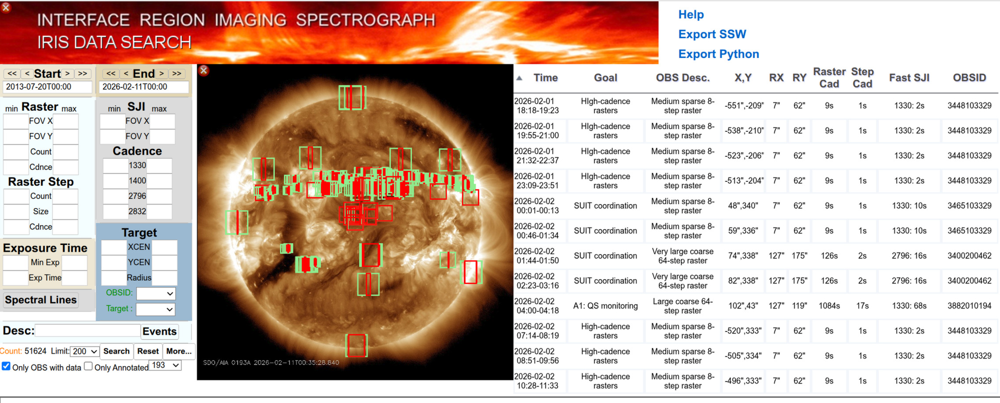
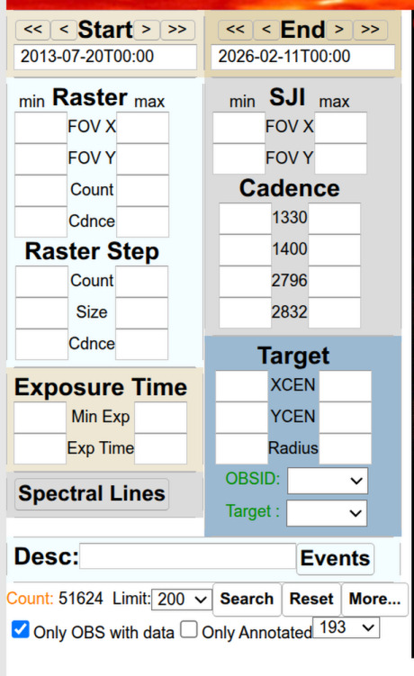
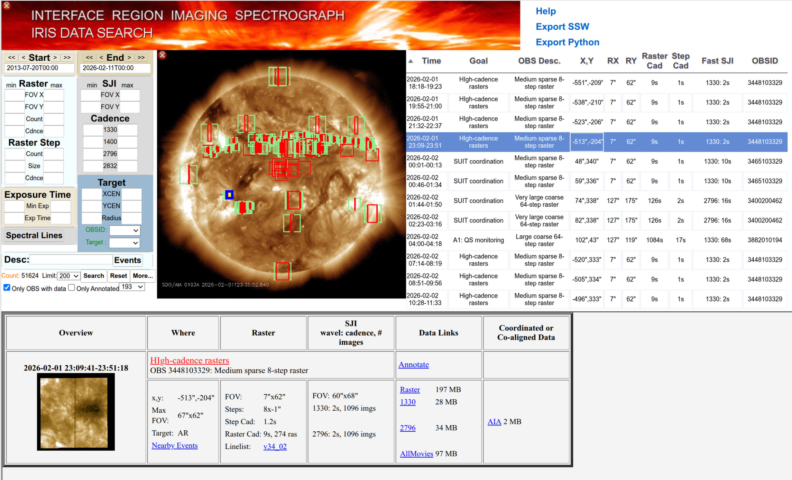
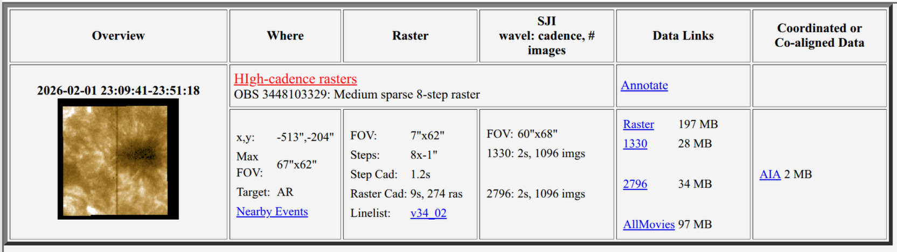

.. _irispy-tutorial-acquiring-data:

**************
Acquiring Data
**************

IRIS data are kept in the `IRIS archive <https://iris.lmsal.com/data.html>`__ at LMSAL.
``irispy`` searches the archive and downloads its files with sunpy's `~sunpy.net.Fido`.
The `IRIS data search webpage <https://iris.lmsal.com/search/>`__ browses the same archive, with images of each observation; the second part of this section shows how to use it.

Searching and downloading with ``Fido``
=======================================

`~sunpy.net.Fido` is sunpy's interface for searching and downloading solar data; :ref:`sunpy-tutorial-acquiring-data-index` introduces it.
Importing `irispy.net` adds `~irispy.net.IRISClient`, which searches the IRIS archive, to ``Fido``, and the IRIS search attributes to ``a.iris``:

.. code-block:: python

    >>> import astropy.units as u
    >>> from sunpy.net import Fido, attrs as a

    >>> import irispy.net

A search needs a time range, `a.Time <sunpy.net.attrs.Time>`, and ``a.Instrument.iris`` or ``a.Provider("LMSAL")``; it finds the observations that overlap the time range, and the ``a.iris`` attributes below narrow it.
Here are the active region observations of the morning of 1 October 2021:

.. code-block:: python

    >>> result = Fido.search(
    ...     a.Time("2021-10-01 06:00", "2021-10-01 07:00"),
    ...     a.Provider("LMSAL"),
    ...     a.iris.Target("AR"),
    ... )  # doctest: +REMOTE_DATA
    >>> result.show("Start Time", "OBSID", "Title", "Product", "Filename", "Size")  # doctest: +REMOTE_DATA
    <sunpy.net.fido_factory.UnifiedResponse object at ...>
    Results from 1 Provider:
    <BLANKLINE>
    5 Results from the IRISClient:
    Source: https://iris.lmsal.com/search/
    Total estimated size: 104.858 Mbyte
    <BLANKLINE>
           Start Time         OBSID         Title       Product                         Filename                          Size
                                                                                                                         Mibyte
    ----------------------- ---------- ---------------- ------- -------------------------------------------------------- ------
    2021-10-01 06:09:25.000 3683602040 Observation test     sji iris_l2_20211001_060925_3683602040_SJI_1330_t000.fits.gz    3.0
    2021-10-01 06:09:30.000 3683602040 Observation test     sji iris_l2_20211001_060925_3683602040_SJI_1400_t000.fits.gz    3.0
    2021-10-01 06:09:26.000 3683602040 Observation test     sji iris_l2_20211001_060925_3683602040_SJI_2796_t000.fits.gz    5.0
    2021-10-01 06:09:28.000 3683602040 Observation test     sji iris_l2_20211001_060925_3683602040_SJI_2832_t000.fits.gz    6.0
    2021-10-01 06:09:25.000 3683602040 Observation test  raster         iris_l2_20211001_060925_3683602040_raster.tar.gz   83.0
    <BLANKLINE>
    <BLANKLINE>

Each row is one file: by default the raster tarball and the slit-jaw files of each observation.
Sizes are the archive's, in whole MiB, and what the archive does not give is masked.
The printed table shows the main columns; ``result["iris"].keys()`` lists them all, and ``show`` shows those it is given, or all with no names:

.. code-block:: python

    >>> print(result["iris"].show("Filename", "Exposure Time", "Cadence", "Rasters", "Steps"))  # doctest: +REMOTE_DATA
                            Filename                         Exposure Time Cadence Rasters Steps
                                                                   s          s
    -------------------------------------------------------- ------------- ------- ------- -----
    iris_l2_20211001_060925_3683602040_SJI_1330_t000.fits.gz      0.500264 6.97684      --    --
    iris_l2_20211001_060925_3683602040_SJI_1400_t000.fits.gz      0.500267 6.97897      --    --
    iris_l2_20211001_060925_3683602040_SJI_2796_t000.fits.gz      0.500259 6.97792      --    --
    iris_l2_20211001_060925_3683602040_SJI_2832_t000.fits.gz      0.500255 6.97871      --    --
            iris_l2_20211001_060925_3683602040_raster.tar.gz           ——— 27.7355       5    16

The other search attributes are:

* `a.iris.ObsID <irispy.net.attrs.ObsID>`: an OBS ID.
* `a.iris.Description <irispy.net.attrs.Description>`: text in the title, goal or science objectives.
* `a.iris.Target <irispy.net.attrs.Target>`: the target, such as ``"AR"`` or ``"QS"``.
* `a.iris.XCen <irispy.net.attrs.XCen>` and `a.iris.YCen <irispy.net.attrs.YCen>`: a range of the pointing.
* `a.iris.Product <irispy.net.attrs.Product>`: other files in place of the raster tarball and slit-jaw files, such as the co-aligned AIA cubes (``"sdo"``); ``Fido`` returns one table for each product combined with ``|``.

The Virtual Solar Observatory lists the same files under the same instrument and provider, so a search without an ``a.iris`` attribute returns its table too; fetch ``result["iris"]`` to download the IRIS archive's files only.
A search of a month takes about a minute and finds at most 5000 observations; ``ObsID``, ``Target``, ``XCen`` and ``YCen`` make it faster.

For example, the Hinode/SOT and AIA data of the observations made with Hinode near the west limb on 3 March 2020:

.. code-block:: python

    >>> limb_result = Fido.search(
    ...     a.Time("2020-03-03", "2020-03-04"),
    ...     a.Provider("LMSAL"),
    ...     a.iris.Description("Hinode"),
    ...     a.iris.XCen(700 * u.arcsec, 1000 * u.arcsec),
    ...     a.iris.Product("sot") | a.iris.Product("sdo"),
    ... )  # doctest: +REMOTE_DATA
    >>> limb_result.show("Start Time", "XCen", "Filename", "Size")  # doctest: +REMOTE_DATA
    <sunpy.net.fido_factory.UnifiedResponse object at ...>
    Results from 2 Providers:
    <BLANKLINE>
    6 Results from the IRISClient:
    Source: https://iris.lmsal.com/search/
    Total estimated size: 39.846 Mbyte
    <BLANKLINE>
           Start Time         XCen                       Filename                     Size
                             arcsec                                                  Mibyte
    ----------------------- -------- ----------------------------------------------- ------
    2020-03-03 14:44:35.000 742.0411 iris_l2_20200303_144435_3605202860_SOTSP.tar.gz    9.0
    2020-03-03 16:24:05.000 755.9626 iris_l2_20200303_162405_3605202860_SOTSP.tar.gz    6.0
    2020-03-03 18:04:05.000 764.1443 iris_l2_20200303_180405_3605202860_SOTSP.tar.gz    6.0
    2020-03-03 19:43:05.000 773.2471 iris_l2_20200303_194305_3605202860_SOTSP.tar.gz    4.0
    2020-03-03 21:18:35.000 783.6635 iris_l2_20200303_211835_3605202860_SOTSP.tar.gz    4.0
    2020-03-03 22:53:35.000 790.7757 iris_l2_20200303_225335_3605202860_SOTSP.tar.gz    9.0
    <BLANKLINE>
    6 Results from the IRISClient:
    Source: https://iris.lmsal.com/search/
    Total estimated size: 4.948 Gbyte
    <BLANKLINE>
           Start Time         XCen                      Filename                    Size
                             arcsec                                                Mibyte
    ----------------------- -------- --------------------------------------------- ------
    2020-03-03 14:44:35.000 742.0411 iris_l2_20200303_144435_3605202860_SDO.tar.gz  715.0
    2020-03-03 16:24:05.000 755.9626 iris_l2_20200303_162405_3605202860_SDO.tar.gz  691.0
    2020-03-03 18:04:05.000 764.1443 iris_l2_20200303_180405_3605202860_SDO.tar.gz  657.0
    2020-03-03 19:43:05.000 773.2471 iris_l2_20200303_194305_3605202860_SDO.tar.gz  530.0
    2020-03-03 21:18:35.000 783.6635 iris_l2_20200303_211835_3605202860_SDO.tar.gz  700.0
    2020-03-03 22:53:35.000 790.7757 iris_l2_20200303_225335_3605202860_SDO.tar.gz 1426.0
    <BLANKLINE>
    <BLANKLINE>

Failed searches are reported in the returned `~sunpy.net.fido_factory.UnifiedResponse` and in the ``errors`` attribute of each `~sunpy.net.base_client.QueryResponseTable` in it.

Downloading data
----------------

`Fido.fetch <sunpy.net.fido_factory.UnifiedDownloaderFactory.fetch>` downloads the files of a search result, a table of it or one row.
Here we download the 1400 slit-jaw file, 3 MiB, of the active region observation:

.. code-block:: python

    >>> table = result["iris"]  # doctest: +REMOTE_DATA
    >>> sji_1400 = table[table["Filename"] == "iris_l2_20211001_060925_3683602040_SJI_1400_t000.fits.gz"]  # doctest: +REMOTE_DATA
    >>> files = Fido.fetch(sji_1400)  # doctest: +REMOTE_DATA
    >>> files  # doctest: +REMOTE_DATA
    <parfive.results.Results object at ...>
    ['.../20211001_060925_3683602040/iris_l2_20211001_060925_3683602040_SJI_1400_t000.fits.gz']

If any files failed to download, the `parfive.Results` object lists the URLs that failed and why in its ``errors`` attribute:

.. code-block:: python

    >>> print(files.errors)  # doctest: +REMOTE_DATA
    []

To retry, pass the `parfive.Results` object back to `Fido.fetch <sunpy.net.fido_factory.UnifiedDownloaderFactory.fetch>`:

.. code-block:: python

    >>> files = Fido.fetch(files)  # doctest: +SKIP

Organizing downloaded data
--------------------------

``Fido`` downloads into sunpy's download folder, ``~/sunpy/data``, unless ``path`` names another.
The files of each observation go into a folder named after the observation, its date, time and OBS ID, such as ``20211001_060925_3683602040``, so `~irispy.io.read_files` reads one observation from its folder:

.. code-block:: python

    >>> from pathlib import Path
    >>> from irispy.io import read_files

    >>> folder = Path(files[0]).parent  # doctest: +REMOTE_DATA
    >>> folder.name  # doctest: +REMOTE_DATA
    '20211001_060925_3683602040'
    >>> read_files(folder).meta.observing_mode_id  # doctest: +REMOTE_DATA
    3683602040

To keep the archive's own layout, ``level2/YYYY/MM/DD/<observation>/``, put the date of the observation, from the hidden ``Observation Start`` column, in ``path``:

.. code-block:: python

    >>> files = Fido.fetch(result, path="~/iris/level2/{observation_start.datetime:%Y/%m/%d}/{file}")  # doctest: +SKIP

which puts the files in ``~/iris/level2/2021/10/01/20211001_060925_3683602040/``.

`~irispy.io.read_files` extracts the raster, SDO and Hinode/SOT tarballs into the ``irispy`` cache folder, not next to the tarballs; :ref:`irispy-known-issues-extracted-archives` says how much space they take and how to extract them elsewhere.

IRIS data search website
========================

The `IRIS data search webpage <https://iris.lmsal.com/search/>`__ is designed to quickly guide researchers to IRIS datasets appropriate for their research.
It consists of five graphical elements and three steps to the data:

#. IRIS Banner
#. Selection widgets
#. Graphical display of search results on a SDO/AIA image
#. Tabular display of search results
#. Dataset browser/inspector with links to download the datasets

The IRIS data search tool is optimized for use on landscape displays of at least 1280x768 pixels.
The banner and the solar image can be hidden (displayed) by clicking on the red (green) buttons in the upper left corners to accommodate smaller screens.
The data search tool has been tested with recent versions of Firefox, Safari and Chrome browsers.
If you have difficulty with the tool, you might first try one of these browsers to ensure compatibility.

**Selection widgets**

There are six widgets available for customized dynamic data searches.
At the most basic, this search consists of specifying the **start** and **end** of a time range of interest.
When first loaded, these default to select the week surrounding the current date.
The **start** and **end** times can be moved forward and back a day or a week by using the single and double arrow buttons.
Specific dates can be entered directly into the text boxes or by using the calendars that pop up when one clicks on them.
The total **count** of datasets available within the time range appears at the bottom left of this selection area.
By default, only datasets that are completely processed are displayed.
If you wish to include ones that are still processing, uncheck the **only OBS with data** box below **count** (not shown in figure).

The remaining widgets are used to filter the selections within the specified time range.
The **count** of available data sets updates dynamically to reflect the effects of your selections.

**Raster**:
Limit results to datasets with rasters within a (**min**, **max**) range of: fields of view in arcseconds; number of repeats (**count**); and of the **cadence** in seconds and with raster steps within a range of number (**count**); size in arcseconds and **cadence** in seconds.

**Slit Jaw Imager (SJI)**:
Limit results to datasets with slit jaw images within a range of fields of view and **cadences** for each wavelength band.

**Exposure time**:
Limit results to datasets within a range of minimum exposure and mean exposure times based on all images within the dataset.

**Target**:
Limit results to a range of target positions relative to disk center in arcseconds either as a bounding box (**xcen**, **ycen**) or an annulus between radii.
Limit sets to specific IRIS Observation IDs or **target**.
The colors of these last two change to indicate the presence (green) or absence (red) of matching datasets based upon other selections.

When all selections are made, clicking the search button refreshes the results in the display area.
**Note that the display does not update while you are constructing a search.**
A range of background SDO/AIA images of the sun corresponding to the start time of query can be selected for the display.
All filters (other than dates) and displays are cleared by clicking the reset button.

**Display Widget**:
The results of a search are displayed on a co-temporal AIA image that is selectable from the search widget.
The default setting displays the bounding boxes for the slit jaw (raster) image as green (red) rectangles on an 193 Å AIA image.
A sortable list of IRIS observations on the right presents details of the dataset including the time interval, short descriptions, pointing, fields of view, cadences and observation IDs.
Clicking on an entry in either widget, highlights the selection in the table along with a detailed description in the inspection widget.

**Inspection Widget**:
The inspection widget shows more details of the dataset, including a thumbnail slit jaw image, pointing information and links to and sizes of the data products (when they become available).
Clicking on the image or title will bring up a separate details page with summary movies, paths to the data and links to the AIA cutout service.
Clicking on the data links will immediately download the corresponding gzipped dataset.

Co-aligned data
---------------

The latest version of the search engine includes the option to find all IRIS observations for which co-aligned SDO and/or Hinode data cubes are available.
This can be done by checking the appropriate option buttons located under the "More" button.
The co-aligned data is explained in detail by `ITN32 <https://iris.lmsal.com/itn32/introduction.html>`__.
``a.iris.Product("sdo")`` and ``a.iris.Product("sot")`` find the same files with ``Fido``.
